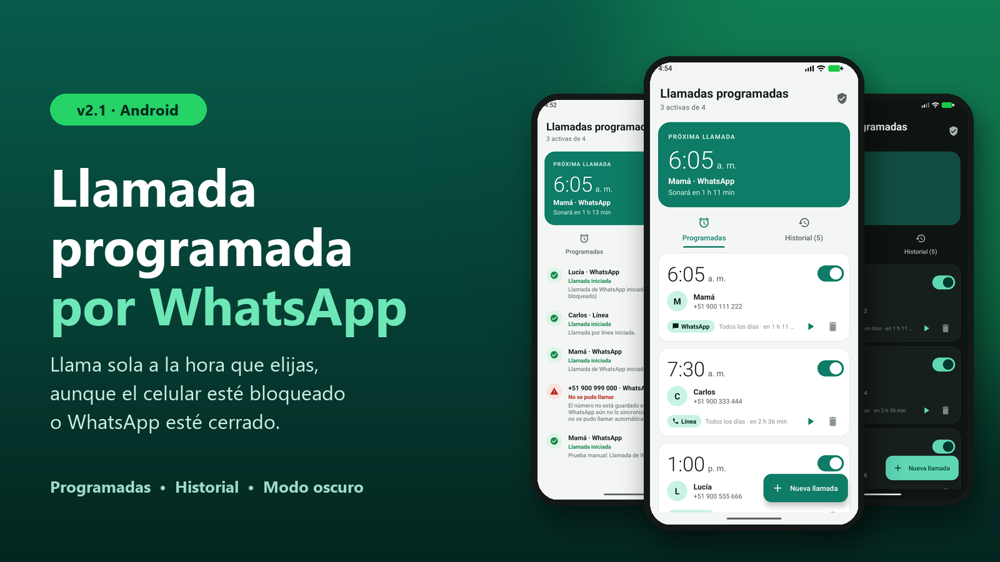
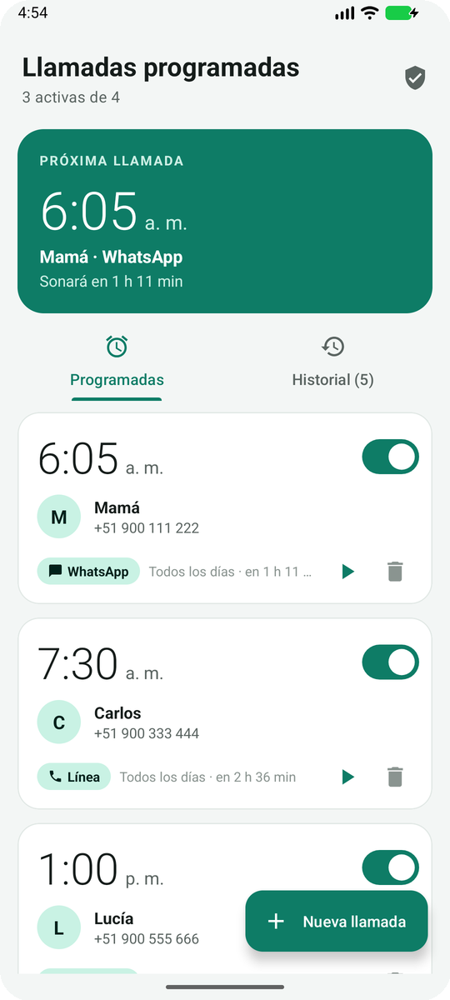
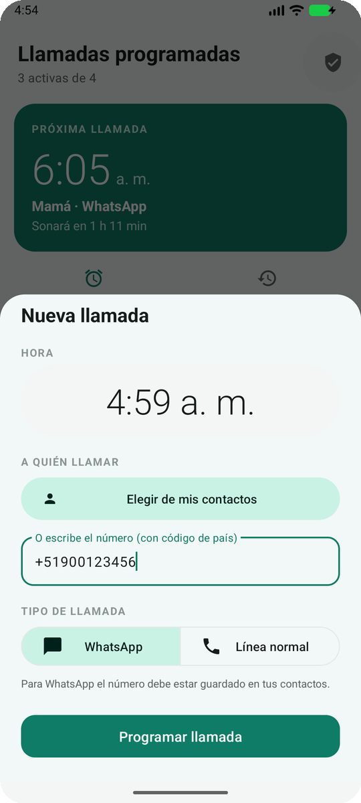
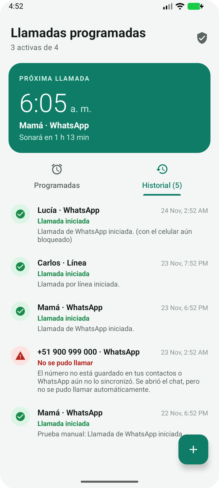
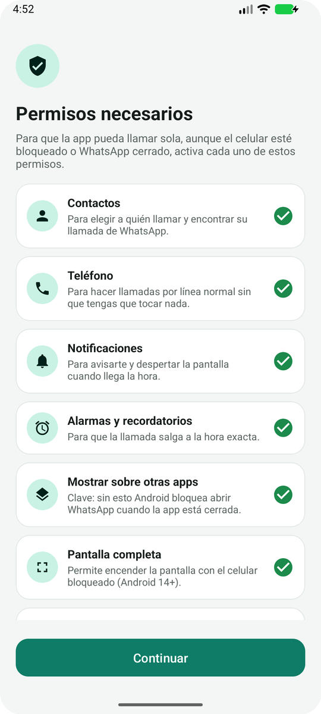
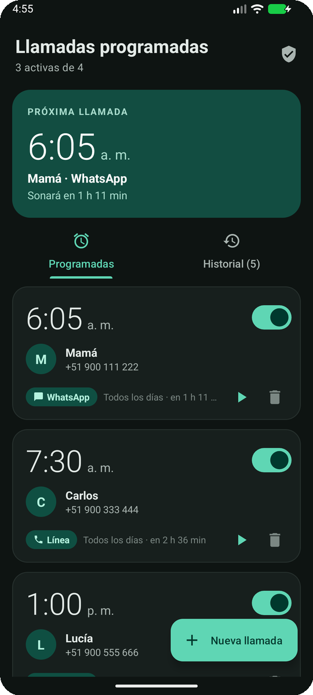

# Llamada programada por WhatsApp



<p align="center">
  <a href="https://github.com/Dinaldo24/llamada-programada-whatsapp/releases/download/v2.1/LlamadaProgramada-v2.1.apk">
    
  </a>
</p>

App Android (Kotlin) que **llama sola a un contacto a la hora que elijas**, por WhatsApp o por línea normal, como si fuera una alarma para la otra persona. Funciona aunque el celular esté bloqueado o WhatsApp esté cerrado.

Probada en un Samsung Galaxy A54 con Android 16.

## Capturas

| Programadas | Nueva llamada | Historial |
|:---:|:---:|:---:|
|  |  |  |
| **Permisos** | **Modo oscuro** | |
|  |  | |

<sub>Capturas con contactos y números de ejemplo.</sub>

## Funciones

- **Programadas:** lista de llamadas con la hora, el contacto, el tipo (WhatsApp o línea) y la cuenta regresiva, más una tarjeta con la próxima llamada. Cada una se puede activar o desactivar, cambiar de hora, probar o eliminar.
- **Historial:** cada llamada que hizo la app con su resultado. Si falló, muestra el motivo exacto (permiso faltante, contacto no encontrado en WhatsApp, etc.).
- **Permisos:** al abrir la app se muestra una lista de lo que necesita, con un botón para activar cada permiso.
- Se repite todos los días y se vuelve a programar al reiniciar el celular.
- Modo claro y oscuro.

## Descargar

Toca el botón verde «Descargar APK» de arriba, o entra a [Releases](../../releases). Al instalarla, Android pedirá permitir «instalar apps desconocidas».

## Permisos necesarios

| Permiso | Para qué |
|---|---|
| Contactos | Elegir a quién llamar y encontrar su «llamada de voz» de WhatsApp |
| Teléfono | Llamar por línea normal sin tocar la pantalla |
| Notificaciones | Avisar y encender la pantalla a la hora programada |
| Alarmas y recordatorios | Que la llamada salga a la hora exacta |
| **Mostrar sobre otras apps** | **Indispensable:** sin esto, Android bloquea abrir WhatsApp con la app cerrada |
| Pantalla completa (Android 14+) | Respaldo para encender la pantalla con el celular bloqueado |
| Batería sin restricciones | Que el sistema no duerma la app |

En Samsung, revisa además que la app **no** esté en *Ajustes → Batería → Límites de uso en segundo plano*. En Xiaomi, activa «Ventanas emergentes en segundo plano» y «Mostrar en pantalla de bloqueo».

## Limitaciones

- Para llamar por WhatsApp, el número **debe estar guardado en tus contactos**: la app usa la fila «Llamada de voz» que WhatsApp crea en la agenda. Si no la encuentra, solo abre el chat.
- Con PIN o patrón, Android no permite saltarse el bloqueo. La app enciende la pantalla e intenta llamar igual; en la prueba con el Galaxy A54 la llamada salió con el celular bloqueado.

## Cómo funciona

1. `AlarmScheduler` programa cada llamada con `AlarmManager.setAlarmClock`, la misma prioridad que la app de Reloj.
2. `AlarmReceiver` despierta la CPU y abre `CallTriggerActivity` de dos formas: directamente y con una notificación de pantalla completa.
3. `CallTriggerActivity` enciende la pantalla, se muestra sobre el bloqueo y pide quitarlo. Después lanza la llamada.
4. `WhatsAppCallHelper` busca en `ContactsContract.Data` la fila `vnd.com.whatsapp.voip.call` del contacto y la abre, lo que inicia la llamada en WhatsApp.
5. `HistorialStore` guarda el resultado de cada intento.

## Compilar

Requisitos: Android Studio y **JDK 17 o 21**. Con JDK 25, Gradle 8.6 falla; en ese caso ve a *Settings → Build Tools → Gradle → Gradle JDK* y elige el 21.

```bash
./gradlew assembleDebug
```

La APK queda en `app/build/outputs/apk/debug/app-debug.apk`.
